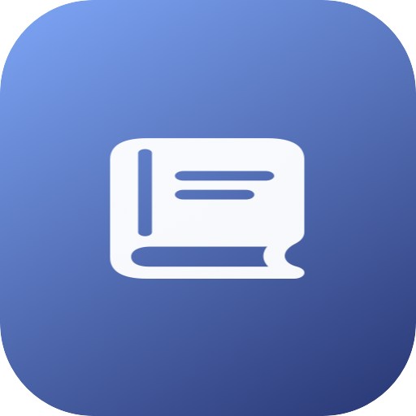

<p align="center">
  
</p>

<h1 align="center">MicroLog</h1>

<p align="center">
  <b>An ambient reading journal that writes itself.</b><br>
  Free, open source, and it all runs on your Mac. Nothing is uploaded.
</p>

<p align="center">
  <a href="#build-from-source"><b>⬇ Build from source</b></a> ·
  <a href="#what-is-it">What is it</a> ·
  <a href="#the-ai-models-it-uses">Models</a> ·
  <a href="#permissions-required">Permissions</a>
</p>

<p align="center">
  
  
  
</p>

<p align="center">
  <!-- TODO: replace with a launch GIF/MP4 once one is recorded, e.g.:
  <a href="assets/video/microlog-launch.mp4"></a>
  -->
  <i>A demo video/GIF goes here once one is recorded.</i>
</p>

---

## What is it?

You read things all day — articles, docs, threads — and most of it evaporates. Highlighting
and clipping is a chore, so it never happens.

**MicroLog just watches you read.** It sits in the menu bar and ambiently notices what's in
front of you: the page title, the selected text, the gist of the window you've been looking at
for a while. Once you've actually spent time on something (not just a glance), it quietly turns
it into a note — title, summary, key points, why it matters, tags — with zero typing.

| While you were reading… | MicroLog keeps… |
|---|---|
| A 4-minute article on vector databases | A note with the summary, key points, and a `#databases` tag |
| The same article again tomorrow | Nothing new — recognized as a duplicate and skipped |
| Three related posts on the same topic over a week | One thread, linked together instead of three stray notes |
| A quick glance at your email client | Nothing — denylisted apps and short dwell times are ignored |

Later you can **browse notes** in the ambient pill or popover, see **why each one mattered**,
and trust that duplicates and rereads won't clutter the list.

## What you get

- **Menu-bar app** — an ambient pill shows the latest note forming; click it for the full popover.
- **Passive capture** — tracks the frontmost app/window, with Accessibility text and a
  ScreenCaptureKit + Vision OCR fallback when there's nothing else to read.
- **Minimum read-time filter** — a window only becomes a note after ~20s dwell and ~150 words,
  so switching apps quickly never creates noise.
- **Dedup & threading** — URL canonicalization, content hashing, SimHash, and embedding
  similarity catch duplicates and reread sessions before they become new notes.
- **On-device summarization** — title, summary, key points, "why it matters," and tags, filled
  in the background while the row shows "Summarizing…".
- **Deny/allow lists** — private apps (Mail, Messages, Terminal, password managers) are skipped
  outright.
- **Private** — see below.

## The AI models it uses

MicroLog downloads two open models the first time it starts. Nothing is sent to any server
after that.

| Job | Model | Link |
|---|---|---|
| Summarization (title, summary, key points, tags) | **Qwen3.5 0.8B** (Q4_K_M) | [lmstudio-community/Qwen3.5-0.8B-GGUF](https://huggingface.co/lmstudio-community/Qwen3.5-0.8B-GGUF) |
| Similarity & dedup embeddings | **EmbeddingGemma 2** (UD-Q4_K_XL) | [unsloth/embeddinggemma-2-GGUF](https://huggingface.co/unsloth/embeddinggemma-2-GGUF) |

EmbeddingGemma 2 is what lets the dedupe engine recognize "this is the same article" or "this
is part of the same thread" even when titles and wording differ.

## Permissions required

- **Accessibility** — read the focused window's text
- **Screen Recording** — OCR fallback when Accessibility text isn't available
- **Automation** — Safari/Chrome scripting for browser URL/title
- **Notifications** — ambient pills when a new note is ready

## Privacy, stated plainly

- All capture, OCR, and summarization run on-device — no analytics, no cloud APIs.
- The only network use is the one-time model download on first launch.
- Denylisted apps (Mail, Messages, Terminal, password managers) are never read.

## How it works (for the curious)

```text
focused app/window ─▶ dwell timer (≥20s, ≥150 words) ─▶ CaptureContext
                                                            │
        DedupeEngine: URL canon · content hash · SimHash · embedding similarity · threads
                                                            │
             unique/related ─▶ row appears ("Summarizing…") ─▶ SummarizerEngine (Qwen3.5)
                                                            │
                                                    SwiftData note store
```

| Layer | Tech |
|---|---|
| App | SwiftUI (macOS menu bar app) |
| Capture | Accessibility API, Scripting Bridge, ScreenCaptureKit + Vision OCR |
| Dedup | Pure Swift `DedupeEngine` (URL canonicalization, content hash, SimHash, embeddings) |
| Summarization | `llama-server` (llama.cpp) running Qwen3.5 0.8B over a local JSON-schema chat endpoint |
| Embeddings | `llama-server` running EmbeddingGemma 2 |
| Storage | SwiftData |

## Build from source

Needs a Mac with Xcode and Apple Silicon.

```sh
open "Untitled Project.xcodeproj"
# Select the MyApp scheme, then build & run (⌘R). Models download on first launch.
```

## Repository layout

```
├── MyApp/
│   ├── Capture/          # FocusCapture, FocusCaptureProvider (Accessibility + OCR)
│   ├── Services/         # DedupeEngine, SummarizerEngine, EmbeddingEngine, ModelManager, SwiftDataNoteStore
│   ├── Protocols/         # CaptureProvider, Summarizer, NoteStore
│   ├── UI/               # AmbientPill, PopoverRoot, NoteRow, NoteDetailView, SettingsView, Theme
│   ├── Models.swift
│   └── MyApp.swift
└── MyAppTests/           # DedupeEngineTests
```

## License

MIT — see [LICENSE](LICENSE).
